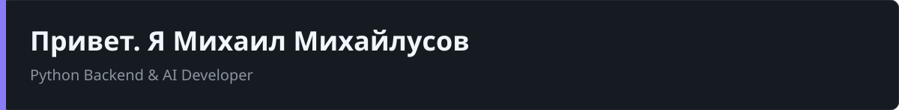

  

  Создаю надежные backend-системы и интегрирую AI в реальные продукты.

  
  
  

---

## Обо мне

> Backend- и AI-разработчик с опытом полного цикла создания продуктов: от проектирования архитектуры и БД до настройки CI/CD и вывода в продакшн.
>
> Специализируюсь на построении надежных систем (модульные монолиты, микросервисы), внедрении AI-функций (RAG, MCP-серверы, pgvector) и обеспечении отказоустойчивости инфраструктуры.

---

## Технологический стек

- **Языки:**   
- **Backend:**   
- **Базы данных и брокеры:**   
- **AI & Интеграции:**   
- **DevOps & Инфраструктура:**   
- **Качество кода:**   

---

## Мои проекты

### [ai-helper](https://github.com/Dontgoingforyou/ai-helper)
Черновик карточки товара для B2B-магазина. Модель предлагает SEO-заголовок и поисковые запросы, код собирает описание и характеристики только из входных фраз и не пропускает новые технические числа. Проверки на pytest, ruff и mypy.

### [myshop](https://github.com/Dontgoingforyou/myshop)
Полноценный интернет-магазин: корзина, оформление заказа, интеграция со Stripe, система купонов, генерация PDF, поддержка двух языков. Написан на Django, письма и фоновые задачи уходят через Celery.

### [myblog](https://github.com/Dontgoingforyou/myblog)
Платформа для блога: посты, комментарии, теги, полнотекстовый поиск и генерация RSS-ленты. Демонстрация работы с Django ORM и оптимизацией запросов.

### [income_and_expense](https://github.com/Dontgoingforyou/income_and_expense)
Учет доходов и расходов: REST API на Django REST Framework, графики за период, фильтрация и выгрузка отчетов в Excel.
